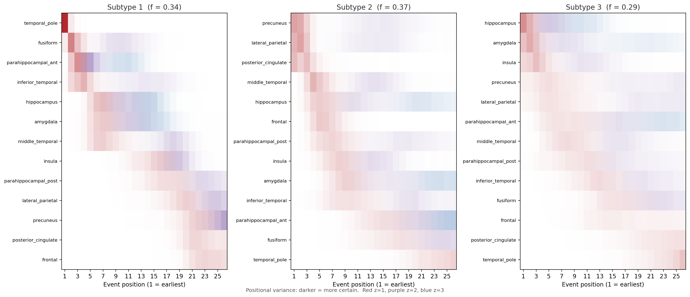

# Data-driven Alzheimer's atrophy subtypes and stages from OASIS-1

Applies **SuStaIn** (Subtype and Stage Inference; Young et al., *Nat Commun* 2018) to
regional grey-matter density from the open OASIS-1 VBM data. From one scan per person, the
model infers (a) whether there are distinct *orders* in which brain regions atrophy
(subtypes) and (b) how far along that order each person is (stage).

Clinical scores (CDR, MMSE) are **never model inputs**. They are held out and used only
to validate the result, which is what makes the stages more than a re-labelling of
diagnosis.

## Pipeline

| Step | What it does | Output |
|---|---|---|
| `prepare` | Downloads OASIS-1 SPM8-normalised VBM grey-matter maps via nilearn; matches maps to subjects by ID; QC (map homogeneity); keeps age ≥ 60 with a CDR; averages GM density in 13 a priori Harvard-Oxford regions; regresses age, sex and eTIV out **using controls only** and z-scores against control residuals (sign flipped so atrophy is positive); picks z thresholds per region that enough patients actually reach | `sustain_inputs.npz`, `cohort.csv`, `zscore_fit.json`, `figures/zscores_by_group.png` |
| `fit` | Fits ZscoreSustain for 1..K subtypes (MCMC) | `sustain/pickle_files/*.pickle` |
| `cv` | Stratified K-fold cross-validation; CVIC for model selection | `cv.npz`, `figures/cvic.png` |
| `analyze` | Loads the CVIC-selected model and validates it | `subjects_*.csv`, `summary_*.json`, figures |

### Validation in `analyze`
1. **Stage vs severity**: Spearman of stage with MMSE and CDR; stage distribution per CDR level.
2. **Baseline**: does staging beat a naive "mean atrophy z" composite at tracking MMSE?
3. **Controls**: what fraction of CDR=0 subjects land at stage 0.
4. **Confound check**: stage vs age in controls (should be near zero after adjustment).
5. **Subtypes**: sizes, assignment certainty (P(subtype)), and clinical profile, with
   Kruskal-Wallis tests on age and MMSE across subtypes.

## Results

190 adults aged 60+ after QC (95 CDR = 0, 95 CDR > 0; 6 excluded for failed segmentation),
13 regions, 26 events, 100k MCMC iterations, 5-fold cross-validation. Every result was
reproduced with the temporal pole removed (12 regions, 25 events), because that region's
mask had the weakest grey-matter coverage.

**Stages track clinical severity**, although CDR and MMSE were never model inputs.

| | With temporal pole | Without |
|---|---|---|
| Median stage at CDR 0 / 0.5 / 1 / 2 | 0 / 4 / 7 / 13 | 0 / 3 / 7 / 13 |
| Stage vs CDR (Kruskal-Wallis) | p = 6e-10 | p = 1e-9 |
| Stage vs MMSE, patients (Spearman) | -0.39 | -0.41 |
| Mean-atrophy baseline vs MMSE, patients | -0.39 | -0.41 |
| Stage vs age, controls | 0.02 | 0.06 |

Staging does not beat average atrophy at tracking MMSE. SuStaIn's contribution here is the
*sequences*, not a better severity score.

**Heterogeneity is real; three subtypes are supported but only marginally better than two.**
Two subtypes beat one in 5/5 held-out folds in both runs (+12 to +17 log-likelihood per fold);
three beat two in 4/5 folds, by only about +1.1 per fold.

**Three atrophy sequences, the same with and without the temporal pole:**



| Patients only (with TP / without) | Temporal-first | Parietal-first | Hippocampus-first |
|---|---|---|---|
| Earliest regions | temporal pole / fusiform, anterior parahippocampal, inferior temporal | precuneus, lateral parietal, posterior cingulate | hippocampus, amygdala, insula |
| n | 27 / 24 | 26 / 26 | 22 / 24 |
| MMSE | 25.1 / 25.1 | 22.3 / 22.2 | 23.6 / 23.8 |
| CDR | 0.67 / 0.67 | 0.65 / 0.65 | 0.80 / 0.79 |
| Age | 77.1 / 76.3 | 76.3 / 75.8 | 75.6 / 76.7 |

The sequences resemble the typical, limbic-predominant and hippocampal-sparing variants
repeatedly described in the AD literature. MMSE differs in the same direction in both runs
(parietal-first worst, temporal-first best; Kruskal-Wallis p = 0.059 and 0.052). With two
subtypes, the split is temporal-first vs parietal/hippocampus-first (patient MMSE 25.2 vs
22.7, p = 0.021; 24.7 vs 22.7, p = 0.062). Subtypes do not differ in age or sex, and controls
are spread across subtypes rather than concentrated in one.

**Subject-level reproducibility** (`compare_runs.py`): across the two feature sets, 95% of
people keep the same subtype (adjusted Rand index 0.85 for 3 subtypes, 0.82 for 2), and
stages correlate at rho = 0.98.

**How to read this.** The sequences are the robust finding. The cognitive differences between
subtypes are consistent in direction but borderline (p = 0.02-0.06, about 25 patients per
group, several tests), so they are a hypothesis, not a result. The two runs share the same
subjects, so they show robustness to feature choice, not independent replication. Stage
numbers are not comparable across subtypes, because the same stage means different regions
are affected in each sequence.

## Setup

Python 3.10 or 3.11 is the safest choice for pySuStaIn.

```bash
python -m venv .venv && source .venv/bin/activate
pip install -r requirements.txt
python tests/test_synthetic.py        # 14 tests, no data or SuStaIn needed
```

## Run

```bash
# 1. Smoke test: 8 regions, short chains, 1-2 subtypes. Minutes. Checks everything works.
python run.py --config configs/quick.yaml

# 2. Real run: 13 regions, 1-3 subtypes, 100k MCMC iterations, 5-fold CV. Hours on a CPU.
python run.py --config configs/full.yaml

# Sanity-check the prepared data before trusting any model output
python diagnose.py --config configs/quick.yaml

# Sensitivity analysis: same model without the temporal pole
python run.py --config configs/full_no_temporal_pole.yaml

# Rerun just the analysis, for the CVIC choice or a fixed number of subtypes (no refit)
python run.py --config configs/full.yaml --steps analyze --n-subtypes 2

# Do the two runs put the same people in the same subtypes?
python compare_runs.py --a configs/full.yaml --b configs/full_no_temporal_pole.yaml --n 3

# Do people's subtype labels match the plotted sequences? (also checked inside analyze)
python check_subtype_labels.py --config configs/full.yaml --n 3
```

Set `sustain.parallel: true` to spread start points across cores. pySuStaIn reuses
pickles it finds in the output folder, so **delete `outputs/<name>/` after changing
regions, z levels or SuStaIn settings**, or give the config a new `name`.

## Design decisions worth defending in a write-up

- **A priori regions.** Chosen from the AD literature, not by which regions separate groups
  in this cohort, so feature selection isn't fitted to the same subjects as the model.
- **Covariate model fit on controls only.** Fitting on everyone would partly regress out
  disease, because patients are older.
- **Age is regressed out.** This removes normal ageing, so stages reflect atrophy beyond what
  is expected for age. The trade-off: any genuine age-disease coupling is removed too. Rerun
  with `covariates: [sex_m, etiv]` as a sensitivity analysis.
- **SPM8 maps, not DARTEL.** nilearn ships two preprocessings of OASIS-1. The DARTEL maps
  failed a basic biological check: grey matter as a fraction of head size *rose* with age
  (rho = +0.20) and moved against OASIS's own nWBV (rho = -0.28). The SPM8 maps pass (-0.38 and
  +0.58), and their regional atrophy tracks MMSE and CDR about as strongly as nWBV does.
  Registration to the atlas was checked visually for both (`check_registration.py`), and
  `diagnose.py` reproduces the comparison.
- **Disease-independent QC.** The primary QC metric is each subject's whole-map correlation with
  the sample mean map (similar to CAT12's sample homogeneity). Segmentation or registration
  failures drop it sharply, atrophy barely moves it. Subjects more than 4 robust SDs below the
  median are excluded. An earlier version excluded on regional z > 8, which mostly removed the
  *most atrophied patients*, biasing the staging; regional values now only act as a loose safety
  net (|robust z| > 15). Everything excluded is listed with its reason in `qc_excluded.csv`, and
  the run aborts if QC would drop more than 5% of subjects.
- **Clipping.** Remaining z-scores are clipped to [-3, Z_max] per region. pySuStaIn multiplies
  likelihoods without log-space arithmetic, so one extreme value can make a subject's likelihood
  exactly zero under every stage and crash the fit with NaNs.
- **Data-driven z levels.** A z=3 event is kept only if ≥10% of patients reach it; otherwise
  SuStaIn would be asked to place events with no supporting data.
- **Subtype labels are verified against the data.** In 3 of 4 fits, pySuStaIn's per-person
  subtype labels (`ml_subtype`, also when recomputed with its own
  `subtype_and_stage_individuals_newData`) were in a different order than its posterior
  sequences (`samples_sequence`), so subtype 1 in the figure was not subtype 1 in the table.
  `analyze` therefore checks every fit: people in each subtype must show the most early-stage
  atrophy in the regions their sequence puts first. If labels and sequences disagree but map
  one-to-one, people are relabelled and the mapping is recorded in the summary; otherwise it
  warns. All reported fits end `ALIGNED` (matching correlations 0.78-0.98). This was caught
  because cross-run comparison showed the same people as "temporal-first" in one run and
  "parietal-first" in the other.
- **Controls are in the fit.** Standard for SuStaIn; they anchor stage 0. Subjects at stage 0
  are reported as subtype 0 ("no detectable abnormality") rather than forced into a subtype.

## Limitations

- **Cross-sectional only.** Stages are inferred, not observed. The strongest validation, people
  advancing in stage on follow-up, needs longitudinal data (MIRIAD, OASIS-2/3).
- **Small cohort** (190 older adults, about 25 patients per subtype). Enough to find stable
  sequences, too few to establish clinical differences between subtypes.
- **Single site and scanner.** No harmonisation needed, but nothing here shows generalisation.
- **VBM density, not volumes.** Not directly comparable with FreeSurfer-based SuStaIn papers.
- **CDR is clinical, not biomarker-confirmed AD.** Some CDR>0 subjects may have other causes.

## Natural extensions
1. Apply the fitted model to MIRIAD's serial scans and test whether stage increases over 2 years.
2. Simulation study: generate data from a known SuStaIn model (pySuStaIn's `simfuns`) at this
   sample size and measure how well subtypes and sequences are recovered.
3. Bootstrap the cohort to quantify sequence stability beyond the two feature sets used here.
4. Compare against EBM (single-subtype event-based model) and k-means on z-scores.

## Data use
OASIS-1 is distributed under the OASIS data use terms (see the agreement nilearn prints on
download). Acknowledge: *Data were provided by OASIS-1: Cross-Sectional: Principal
Investigators: D. Marcus, R. Buckner, J. Csernansky, J. Morris; P50 AG05681, P01 AG03991,
P01 AG026276, R01 AG021910, P20 MH071616, U24 RR021382*, and cite Marcus et al., 2007
(doi:10.1162/jocn.2007.19.9.1498). Do not commit the data; `data/` and `outputs/` are
git-ignored.

## Layout
```
run.py                   CLI: prepare -> fit -> cv -> analyze
configs/                 quick.yaml (smoke test), full.yaml (main run),
                         full_no_temporal_pole.yaml (sensitivity analysis)
diagnose.py              input sanity checks (DARTEL vs SPM8, signal vs nWBV)
check_registration.py    atlas-on-scan overlay figures
compare_runs.py          subject-level agreement between two fitted runs
check_subtype_labels.py  standalone label/sequence alignment check
docs/figures/            figures used in this README
src/oasis_sustain/
  config.py              defaults + YAML merge
  data.py                nilearn fetch, metadata cleanup, cohort selection
  features.py            atlas resampling, region masks, regional means
  zscore.py              control-based covariate adjustment, z levels, event table
  model.py               version-tolerant pySuStaIn wrappers, CV folds, result loading
  analysis.py            positional variance, validation statistics
  plots.py               figures
tests/test_synthetic.py  runs without data or pySuStaIn
```
