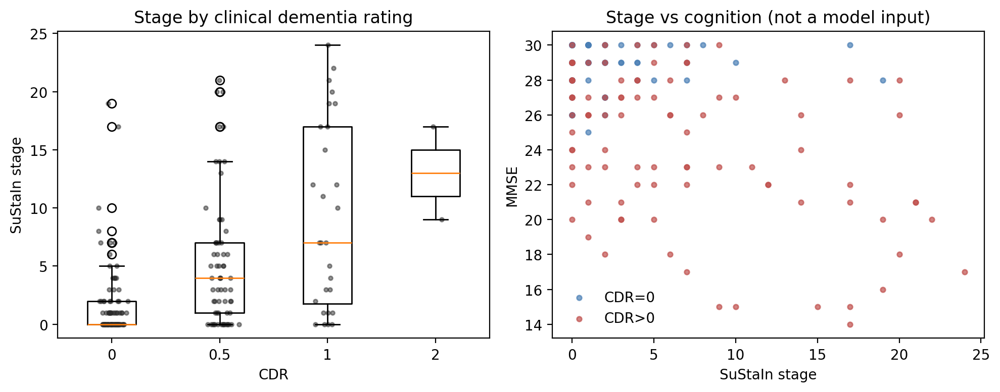

# Data-driven Alzheimer's atrophy subtypes and stages from OASIS-1

This project asks two questions about Alzheimer's disease (AD), using one brain MRI scan per
person:

1. **Does atrophy spread through the brain in the same order in everyone, or are there
   distinct sequences (subtypes)?**
2. **From a single scan, can I tell how far along that sequence a person is (their stage)?**

To answer them I apply **SuStaIn** (Subtype and Stage Inference; Young et al., *Nature
Communications*, 2018) to regional grey-matter density from the open OASIS-1 dataset.

> This is a research and learning project, not a medical tool. It cannot diagnose anyone.

---

## Background

In AD, brain regions lose grey matter as neurons die, and this atrophy appears in a broadly
predictable order. The difficulty is that most datasets contain **one scan per person**: a
snapshot, not a time series. SuStaIn gets around this by treating a large cross-sectional
cohort as people sampled at different points along one or more disease trajectories. From
many snapshots it infers:

- **the sequence(s)** in which regions become abnormal (each distinct sequence is a
  *subtype*), and
- **each person's stage**: how many events along their sequence have already occurred.

An *event* here is a region reaching a given level of abnormality (a z-score of 1, 2 or 3
relative to healthy controls). Stage 0 means no detectable abnormality.

**Clinical scores are never model inputs.** The dementia rating (CDR) and the memory and
thinking test (MMSE) are held out and used only afterwards to validate the result. That is
what makes the stages more than a re-labelling of diagnosis.

## Data

**OASIS-1** (Open Access Series of Imaging Studies; Marcus et al., 2007) is a free, public
collection of T1-weighted MRI scans, here in its voxel-based morphometry (VBM) form: maps of
grey-matter density, normalised to a common template. After quality control the cohort is
**190 adults aged 60 and over**: 95 cognitively normal (CDR = 0) and 95 with very mild to
moderate dementia (CDR > 0). Six were excluded for failed segmentation.

For each person I measure the average grey-matter density in **13 regions** chosen in advance
from the AD literature (Harvard-Oxford atlas), giving 26 events in total.

## Method

The pipeline runs in four steps (`run.py`):

| Step | What it does | Output |
|---|---|---|
| `prepare` | Downloads the OASIS-1 SPM8-normalised grey-matter maps via nilearn and matches them to subjects by ID; runs quality control (map homogeneity); keeps age ≥ 60 with a CDR; averages density in the 13 regions; removes the effects of age, sex and head size (eTIV) **using a model fit on controls only**; converts to z-scores against controls, sign-flipped so atrophy is positive; keeps only z levels that enough patients actually reach | `sustain_inputs.npz`, `cohort.csv`, `zscore_fit.json`, `figures/zscores_by_group.png` |
| `fit` | Fits the z-score SuStaIn model for 1 to K subtypes using MCMC | `sustain/pickle_files/*.pickle` |
| `cv` | Stratified 5-fold cross-validation; the cross-validation information criterion (CVIC) chooses the number of subtypes | `cv.npz`, `figures/cvic.png` |
| `analyze` | Loads the selected model and validates it (below) | `subjects_*.csv`, `summary_*.json`, figures |

The `analyze` step checks:

1. **Stage vs severity:** Spearman correlation of stage with MMSE and CDR, and the stage
   distribution at each CDR level.
2. **Baseline:** does staging track MMSE better than a naive score, the mean atrophy z-score?
3. **Controls:** what fraction of healthy subjects land at stage 0.
4. **Confounding by age:** stage vs age in controls (should be near zero after adjustment).
5. **Subtypes:** sizes, assignment certainty, and clinical profile, with Kruskal-Wallis tests
   on age and MMSE across subtypes.

The main run uses 100,000 MCMC iterations. Every result was **reproduced with the temporal
pole removed** (12 regions, 25 events), because that region's mask had the weakest
grey-matter coverage and was the least reliable.

## Results

### 1. Three atrophy sequences

Atrophy does not spread the same way in everyone. The model finds three sequences, and they
are the same with and without the temporal pole:


*How to read this figure: each panel is one subtype. Each row is a brain region, and moving
left to right is moving forward in the disease. A dark square means "this region becomes
abnormal at this stage", and the shade reflects how certain the model is. In each panel the
regions at the top are affected first.*

| Patients only (with temporal pole / without) | Temporal-first | Parietal-first | Hippocampus-first |
|---|---|---|---|
| Earliest regions | temporal pole / fusiform, anterior parahippocampal, inferior temporal | precuneus, lateral parietal, posterior cingulate | hippocampus, amygdala, insula |
| Latest regions | parietal, posterior cingulate, frontal | amygdala, anterior parahippocampal, fusiform, temporal pole | frontal, posterior cingulate, temporal pole |
| Closest published variant | limbic-predominant | hippocampal-sparing | typical |
| n | 27 / 24 | 26 / 26 | 22 / 24 |
| MMSE (mean) | 25.1 / 25.1 | 22.3 / 22.2 | 23.6 / 23.8 |
| CDR (mean) | 0.67 / 0.67 | 0.65 / 0.65 | 0.80 / 0.79 |
| Age (mean) | 77.1 / 76.3 | 76.3 / 75.8 | 75.6 / 76.7 |

In plain terms: one group's atrophy starts in the sides of the brain (temporal lobes), one
starts at the top and back (parietal cortex) and reaches the memory centre later, and one
starts in the memory centre itself (hippocampus), the "classic" AD pattern.

**How these map onto known AD variants.** Studies of much larger cohorts repeatedly describe
three main atrophy patterns in AD: *typical* (medial temporal lobe and association cortex
both affected), *limbic-predominant* (medial and anterior temporal lobe affected, cortex
relatively spared) and *hippocampal-sparing* (cortex, especially parietal, affected and the
medial temporal lobe relatively spared) (Ferreira et al., 2020). SuStaIn's original AD
analysis found comparable sequences, which it called typical and cortical (Young et al., 2018).
Reading the full sequences in the figure:

- **Parietal-first ≈ hippocampal-sparing** (SuStaIn's "cortical"). Precuneus, lateral
  parietal and posterior cingulate come first. The amygdala, anterior parahippocampal gyrus,
  fusiform and temporal pole come last. This is the clearest match.
- **Hippocampus-first ≈ typical.** Hippocampus and amygdala come first, as in SuStaIn's
  typical subtype, but the parietal regions follow early (around positions 4-8), so the
  pattern soon involves both the medial temporal lobe and the cortex.
- **Temporal-first ≈ limbic-predominant.** Anterior temporal and anterior medial temporal
  regions (temporal pole, fusiform, anterior parahippocampal gyrus) come first, then
  hippocampus and amygdala. Parietal and frontal cortex are spared until the very end. This
  match is the loosest: the earliest regions are anterior and inferior temporal rather than
  the hippocampus itself.

The clinical profiles point the same way. In the literature, hippocampal-sparing patients
tend to be more cognitively impaired and limbic-predominant patients less so. Here,
parietal-first has the lowest MMSE and temporal-first the highest (see point 4 below).

I keep the anatomical names (temporal-, parietal-, hippocampus-first) as the labels because
they describe what the model actually found. The published variants were defined differently
(from the ratio of hippocampal to cortical atrophy, or from post-mortem pathology, not from
sequences), and the correspondence is approximate. The sequences also blur: hippocampus
reaches a mild abnormality (z = 1) around the middle of the parietal-first sequence, so the
"sparing" is relative rather than absolute. Still, finding these three patterns independently
in a small open dataset suggests the model is picking up real structure.

Subtypes do not differ in age or sex, and healthy controls are spread across subtypes rather
than concentrated in one.

**How strongly is three supported?** Heterogeneity itself is clear: two subtypes beat one in
5/5 held-out folds in both runs (+12 to +17 log-likelihood per fold). Three beat two in 4/5
folds, but only by about +1.1 per fold, so three subtypes are supported but only marginally
better than two. With two subtypes, the split is temporal-first vs parietal/hippocampus-first.

### 2. Stages track clinical severity

Each person gets a stage, like a progress bar along their sequence. Although CDR and MMSE
were never model inputs, stage rises steadily with dementia severity:

| | With temporal pole | Without |
|---|---|---|
| Median stage at CDR 0 / 0.5 / 1 / 2 (none / very mild / mild / moderate) | 0 / 4 / 7 / 13 | 0 / 3 / 7 / 13 |
| Stage vs CDR (Kruskal-Wallis) | p = 6e-10 | p = 1e-9 |
| Stage vs MMSE, patients (Spearman ρ) | -0.39 | -0.41 |
| Mean-atrophy baseline vs MMSE, patients (Spearman ρ) | -0.39 | -0.41 |
| Stage vs age, controls (Spearman ρ) | 0.02 | 0.06 |



*How to read this figure: on the left, each box is a group of people with the same CDR, and
the line in the box is the median stage. The boxes climb from left to right: the more severe
the dementia, the higher the stage. On the right, each dot is a person; higher stages go with
lower MMSE scores.*

Two points are worth noting. First, stage reflects disease rather than age: among controls,
older people do not get higher stages. Second, **staging does not beat simple average atrophy
at tracking MMSE** (both ρ ≈ -0.4). SuStaIn's contribution here is the *sequences*, not a
better severity score.

### 3. The results are robust

- Removing the temporal pole reproduces the same three sequences.
- Across the two runs, **95% of people keep the same subtype** (adjusted Rand index 0.85 for
  three subtypes, 0.82 for two), and stages correlate at ρ = 0.98 (`diagnostics/compare_runs.py`).

### 4. A hint of cognitive differences (a hypothesis, not a finding)

Patients on the parietal-first path had the lowest MMSE and those on the temporal-first path
the highest, despite similar CDR. The direction is the same in both runs, but the evidence is
borderline (Kruskal-Wallis p = 0.059 and 0.052; with two subtypes, MMSE 25.2 vs 22.7,
p = 0.021, and 24.7 vs 22.7, p = 0.062). With about 25 patients per group and several tests,
this is a question for a larger study.

### How to read these results

The sequences are the robust finding. The cognitive differences between subtypes are
consistent in direction but not established. The two runs share the same subjects, so they
show robustness to the choice of regions, not independent replication. Stage numbers are not
comparable across subtypes, because the same stage means different regions are affected in
each sequence.

## Checking my own work

A large part of this project was making sure the results could be trusted. Three problems
were caught and fixed along the way:

1. **Faulty preprocessing.** nilearn ships two preprocessed versions of OASIS-1. The first one
   I used (DARTEL) made healthy brains appear to *gain* grey matter with age, which is
   biologically impossible: grey matter as a fraction of head size rose with age (ρ = +0.20)
   and moved against OASIS's own whole-brain volume measure, nWBV (ρ = -0.28). The SPM8
   version passes both checks (-0.38 and +0.58), and its regional atrophy tracks MMSE and CDR
   about as strongly as nWBV does. `diagnostics/diagnose.py` reproduces this comparison, and
   atlas registration was checked visually for both (`diagnostics/check_registration.py`).
2. **A quality filter that removed the wrong people.** An early filter excluded subjects with
   any regional z > 8. That mostly removed the *most atrophied patients*, which biases staging.
   It was replaced with a disease-independent check (see Design decisions).
3. **Mismatched subtype labels.** pySuStaIn's per-person subtype labels were sometimes in a
   different order from its subtype sequences, so subtype 1 in the figure was not subtype 1 in
   the table. This surfaced when the cross-run comparison showed the same people as
   "temporal-first" in one run and "parietal-first" in the other. `analyze` now checks every
   fit automatically (see Design decisions).

## Design decisions

- **Regions chosen in advance.** The 13 regions come from the AD literature, not from which
  regions separate groups in this cohort, so feature selection isn't fitted to the same
  subjects as the model.
- **Covariate model fit on controls only.** Fitting on everyone would partly remove disease
  along with age, because patients are older.
- **Age is regressed out.** This removes normal ageing, so stages reflect atrophy beyond what
  is expected for age. The trade-off is that any genuine age-disease coupling is removed too.
  A sensitivity analysis can rerun with `covariates: [sex_m, etiv]`.
- **SPM8 maps, not DARTEL**, for the reasons in point 1 above.
- **Disease-independent quality control.** The main QC metric is each subject's whole-map
  correlation with the sample mean map (similar to CAT12's sample homogeneity). Segmentation
  or registration failures drop it sharply, while atrophy barely moves it. Subjects more than
  4 robust SDs below the median are excluded. Regional values only act as a loose safety net
  (|robust z| > 15). Every exclusion is listed with its reason in `qc_excluded.csv`, and the
  run aborts if QC would drop more than 5% of subjects.
- **Clipping.** Z-scores are clipped to [-3, Z_max] per region. pySuStaIn multiplies
  likelihoods directly rather than in log space, so one extreme value can make a subject's
  likelihood exactly zero at every stage and crash the fit.
- **Data-driven z levels.** A z = 3 event is kept only if at least 10% of patients reach it;
  otherwise SuStaIn would be asked to place events with no supporting data.
- **Subtype labels are verified against the data.** In 3 of 4 fits, pySuStaIn's per-person
  labels (`ml_subtype`, also when recomputed with its own
  `subtype_and_stage_individuals_newData`) were ordered differently from its posterior
  sequences (`samples_sequence`). `analyze` therefore checks that the people in each subtype
  show the most early-stage atrophy in the regions their sequence puts first. If labels and
  sequences disagree but map one-to-one, people are relabelled and the mapping is recorded in
  the summary; otherwise it warns. All reported fits end `ALIGNED` (matching correlations
  0.78-0.98).
- **Controls are included in the fit.** This is standard for SuStaIn: they anchor stage 0.
  Subjects at stage 0 are reported as subtype 0 ("no detectable abnormality") rather than
  forced into a subtype.

## Limitations

- **Cross-sectional only.** Stages are inferred, not observed. The strongest validation,
  people advancing in stage on follow-up, needs longitudinal data (MIRIAD, OASIS-2/3).
- **Small cohort** (190 older adults, about 25 patients per subtype). Enough to find stable
  sequences, too few to establish clinical differences between subtypes.
- **Single site and scanner.** No harmonisation was needed, but nothing here shows that the
  results generalise.
- **VBM density, not volumes.** Not directly comparable with FreeSurfer-based SuStaIn studies.
- **CDR is a clinical rating, not biomarker-confirmed AD.** Some CDR > 0 subjects may have
  other causes of dementia.
- **Not a diagnostic tool.** The model describes patterns across a group; it does not tell any
  individual what is happening in their brain.

## Next steps

1. Apply the fitted model to MIRIAD's serial scans and test whether stage increases over two
   years.
2. Simulation study: generate data from a known SuStaIn model (pySuStaIn's `simfuns`) at this
   sample size and measure how well subtypes and sequences are recovered.
3. Bootstrap the cohort to quantify sequence stability beyond the two region sets used here.
4. Compare against a single-subtype event-based model (EBM) and k-means on the z-scores.

## Running the code

### Setup

Python 3.10 or 3.11 is the safest choice for pySuStaIn.

```bash
python -m venv .venv && source .venv/bin/activate
pip install -r requirements.txt
python tests/test_synthetic.py        # 14 tests, no data or SuStaIn needed
```

### Main pipeline

```bash
# Smoke test: 8 regions, short chains, 1-2 subtypes. Minutes. Checks everything works.
python run.py --config configs/quick.yaml

# Main run: 13 regions, 1-3 subtypes, 100k MCMC iterations, 5-fold CV. Hours on a CPU.
python run.py --config configs/full.yaml

# Sensitivity analysis: same model without the temporal pole
python run.py --config configs/full_no_temporal_pole.yaml

# Rerun just the analysis, for the CVIC choice or a fixed number of subtypes (no refit)
python run.py --config configs/full.yaml --steps analyze --n-subtypes 2
```

### Diagnostics

Run these from the repository root.

```bash
# Sanity-check the prepared data before trusting any model output
python diagnostics/diagnose.py --config configs/quick.yaml

# Overlay the atlas regions on the scans to check registration
python diagnostics/check_registration.py --config configs/quick.yaml

# Do the two runs put the same people in the same subtypes?
python diagnostics/compare_runs.py --a configs/full.yaml --b configs/full_no_temporal_pole.yaml --n 3

# Do people's subtype labels match the plotted sequences? (also checked inside analyze)
python diagnostics/check_subtype_labels.py --config configs/full.yaml --n 3
```

Set `sustain.parallel: true` to spread start points across cores. pySuStaIn reuses pickles
it finds in the output folder, so **delete `outputs/<name>/` after changing regions, z levels
or SuStaIn settings**, or give the config a new `name`.

### Layout

```
README.md                this document
run.py                   CLI: prepare -> fit -> cv -> analyze
configs/                 quick.yaml (smoke test), full.yaml (main run),
                         full_no_temporal_pole.yaml (sensitivity analysis)
diagnostics/
  diagnose.py            input sanity checks (DARTEL vs SPM8, signal vs nWBV)
  check_registration.py  atlas-on-scan overlay figures
  compare_runs.py        subject-level agreement between two fitted runs
  check_subtype_labels.py  standalone label/sequence alignment check
docs/figures/            figures used in this README
src/oasis_sustain/
  config.py              defaults + YAML merge
  data.py                nilearn fetch, metadata cleanup, cohort selection
  features.py            atlas resampling, region masks, regional means
  zscore.py              control-based covariate adjustment, z levels, event table
  model.py               version-tolerant pySuStaIn wrappers, CV folds, result loading
  analysis.py            positional variance, validation statistics
  plots.py               figures
tests/test_synthetic.py  runs without data or pySuStaIn
```

## Data use and references

OASIS-1 is distributed under the OASIS data use terms (see the agreement nilearn prints on
download). Acknowledgement: *Data were provided by OASIS-1: Cross-Sectional: Principal
Investigators: D. Marcus, R. Buckner, J. Csernansky, J. Morris; P50 AG05681, P01 AG03991,
P01 AG026276, R01 AG021910, P20 MH071616, U24 RR021382.* Do not commit the data; `data/` and
`outputs/` are git-ignored.

- Marcus et al. (2007). Open Access Series of Imaging Studies (OASIS): cross-sectional MRI
  data in young, middle aged, nondemented, and demented older adults. *Journal of Cognitive
  Neuroscience*. doi:10.1162/jocn.2007.19.9.1498
- Ferreira et al. (2020). Biological subtypes of Alzheimer disease: a systematic review and
  meta-analysis. *Neurology*. doi:10.1212/WNL.0000000000009058
- Young et al. (2018). Uncovering the heterogeneity and temporal complexity of
  neurodegenerative diseases with Subtype and Stage Inference. *Nature Communications*.
- Data: [OASIS](https://sites.wustl.edu/oasisbrains/)
